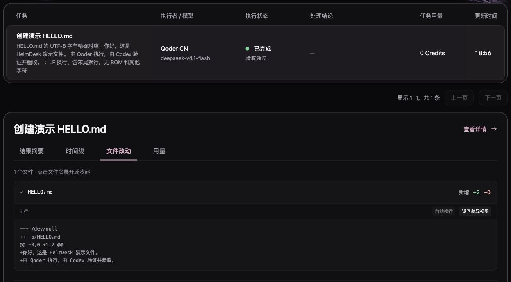

# 把 AI 任务变成可验收的交付

把任务交给 AI 之后，我最想确认的是三件事：它到底改了什么，检查是否真的执行过，这次交付能不能接受。

HelmDesk（领航台）把这段过程留在本机工作台。Codex 负责明确范围、独立验证和验收，Qoder 在独立工作区执行，HelmDesk 保存任务、差异和证据。**执行完成、验证通过、验收接受是三个分别记录的状态。**

[下载 Mac 应用](https://github.com/Mu-Miao/HelmDesk/releases/tag/v0.1.0-macos-preview.7) · [第一次任务教程](https://github.com/Mu-Miao/HelmDesk/blob/main/docs/quickstart.md) · [免费官方 Skill](https://www.agensi.io/skills/helmdesk-workflow-delegate-verify-review)



[观看 55 秒工作流演示](https://github.com/Mu-Miao/HelmDesk/releases/download/v0.1.0-macos-preview.7/helmdesk-workflow-demo.mp4)。这是 2026-11-05 已验收任务的真实截图剪辑回放，非连续录屏；界面中的零用量不表示免费调用。

## 先确认是否适合你的环境

当前安装产物面向 Apple Silicon Mac。部署目标是 macOS 14+，实际本机验收环境为 macOS 27；Intel 和其他 Mac 尚未独立验证。预发布应用只有 ad-hoc 本地签名，没有 Developer ID 签名和 Apple 公证，首次打开可能被 macOS 阻止。请先阅读[安装与故障处理](https://github.com/Mu-Miao/HelmDesk/blob/main/docs/macos-install.md)。

还需要已安装并登录的 Qoder CN 官方 App 或兼容 CLI，以及能连接本地 MCP、读取项目文件和运行检查命令的宿主。官方 Skill 目前验证的是 Codex 宿主 + Qoder 执行器，指令与示例为中文。

Skill 免费，模型调用使用你自己的账号，可能产生费用。本地工作台并不意味着模型离线运行；所选模型供应商仍可能接收请求。

## 1. 安装应用，接通本机 MCP

从 Releases 下载 DMG，将 HelmDesk.app 拖入 Applications 后打开。在设置里授权一个具体的项目目录，确认 Qoder 已登录，保留已有模型或明确选择账号支持的模型。

应用内置 Node、后端和网页，使用安装包不需要再运行 npm。源码方式需要 Git 和 Node.js 24+。请在普通项目目录运行后台，不要把后台代码放在 `~/.codex/` 或 `~/.agents/`：HelmDesk 会禁止执行器读取这些宿主配置目录，放在其中的 worker 也会被阻止。该情况会发生在位于这些目录中的开发工作区，正常 Applications 安装不受这条路径限制影响。

源码安装命令：

```sh
git clone https://github.com/Mu-Miao/HelmDesk.git
cd HelmDesk
npm ci
npm run build
```

在应用设置中导出 MCP 配置，检查路径后补充到宿主配置中，保留原有内容。源码接入的完整配置与后台启动步骤见[快速上手](https://github.com/Mu-Miao/HelmDesk/blob/main/docs/quickstart.md)。**MCP 与界面必须连接同一个数据目录的服务。**

重新连接后，先让宿主调用 `queue_get` 读取队列。这不会发起模型推理。工具缺失时先排查连接，不要用反复派发任务测试登录。

## 2. 加载官方工作流 Skill

官方 Skill 已通过 Agensi 审核并免费上架：

[HelmDesk Workflow: Delegate, Verify & Review](https://www.agensi.io/skills/helmdesk-workflow-delegate-verify-review)

也可从 GitHub 获取完整的 [helmdesk-workflow 文件夹](https://github.com/Mu-Miao/HelmDesk/tree/main/skills/helmdesk-workflow)，按宿主支持的方式加载。保留 `SKILL.md`、`agents`、`assets` 和 `references` 的目录结构。配置模板使用占位路径，需要替换成本机实际路径。

Agensi 分发的是 Skill 包，本机 HelmDesk MCP 需要另外安装、连接。Skill 告诉宿主如何派发和审核，实际隔离与写入限制由 HelmDesk 运行时执行。负责派发、验证和审核的这个 Skill 不应共享给执行者。

## 3. 从一个小而明确的任务开始

第一次建议使用专用、干净且已有提交的 Git 仓库。不要直接用有未提交工作的主项目。普通子文件夹可能被识别为外层 Git 仓库的一部分，必须确认项目路径指向实际仓库根目录。

在你准备的演示目录中初始化仓库、创建 README 并提交，然后在 HelmDesk 授权该目录。若不熟悉这一步，可直接使用[快速上手中的专用演示仓库命令](https://github.com/Mu-Miao/HelmDesk/blob/main/docs/quickstart.md#3-建一个专用演示仓库)。

把以下要求发给宿主，并明确选择你刚创建的演示项目：

> 使用 helmdesk-workflow，通过领航台在我选定的干净演示仓库中创建 HELLO.md。沿用已保存的 Qoder 模型，只允许写入 HELLO.md。文件使用 UTF-8 无 BOM，恰好两行：第一行“你好，这是 HelmDesk 演示文件。”，第二行“由 Qoder 执行，由 Codex 验证并验收。”，每行以 LF 结束。完成后读取完整交付、核对哈希和原项目未变，分别记录验证与验收。暂不整合；失败不自动重试。

这里的“只允许 HELLO.md”是执行范围，“恰好两行、编码和换行明确”是可以逐项检查的验收条件。“做一个不错的演示”不够具体，无法据此判断交付是否达标。

## 4. 执行完成后，先检查完整交付

宿主通过 `task_submit` 派发任务；任务对象返回的 `id` 用作后续工具的 `taskId`。省略模型参数会沿用 HelmDesk 保存的默认值，不需要为了演示另选模型。

等待过程中优先读取紧凑摘要，再用 `tasks_watch` 有界等待状态变化；单次等待窗口结束不表示任务失败，也不应重新提交同一个任务。

出现 `completed` 后，宿主还要调用 `task_get`，读取完整文件并检查：

- 改动列表是否只有允许的 `HELLO.md`。
- 内容、UTF-8 编码、无 BOM、两行 LF 和末尾换行是否精确符合要求。
- 实际字节数和 SHA-256 是否与记录相符。
- 独立工作区身份是否正确，原仓库 HEAD、README 和干净状态是否保持。
- 原项目目录是否仍然没有 `HELLO.md`，实际隔离与文件权限事件是否符合约定。

不能只看 Agent 的“已经完成”摘要，也不能把截断差异当成完整文件。

## 5. 验证与验收分别记录

宿主实际执行检查后，用 `task_verify` 记录真实命令、证据和结果。通过后，再用 `task_review` 接受当前交付。交付版本变化后，旧验证不能继续放行新的文件。

如果检查失败，就记录失败与返工原因。执行器失败或等待用户处理时保留记录，不自动重试，不自动切换模型、执行器或凭据。

2026 年 11 月 5 日，我们已经完成过上述 HELLO.md 的本机真实验证。下面是脱敏后的历史结果，**不是声称刚刚在读者的电脑上执行了任务**：

| 阶段 | 实际记录 |
| --- | --- |
| 执行器 | Qoder，沿用保存的 deepseek-v4.1-flash |
| 执行 | completed |
| 宿主独立验证 | passed，绑定当时的交付版本 |
| 验收 | accepted，在验证后单独记录 |
| 整合回原项目 | 未执行 |

完整交付内容：

```text
你好，这是 HelmDesk 演示文件。
由 Qoder 执行，由 Codex 验证并验收。
```

文件实际为 **89 字节**，UTF-8 无 BOM，两行均以 LF 结束，包括文件末尾。

```text
SHA-256
bb8229d00941bb3775924b9084fcd30ca0442d1abedb8b7cc3c7e200b4d49984
```

宿主核对了完整字节、单文件范围、原仓库基线和实际 Read/Write 事件；验证和验收分别保存。上游当时返回零用量，原值保留，但这不能证明模型调用免费。

## 6. 接受交付之后，再决定是否整合

验收表示你接受了这份独立工作区中的交付。它不会自动合并分支、把文件写回原项目或发布代码。

需要整合时，另行明确选择文件，由宿主先检查原项目基线与当前内容是否冲突，导出并审阅补丁，再明确应用。第一次体验先停在验收阶段，更容易看清各个状态的区别。

这套流程也适用于更实际的开发任务，例如只允许修改一个函数，由宿主运行原有测试。对应的函数修复演示正在准备；尚未完成验证的案例不会作为成功结果展示。

## 使用中卡住时，记录卡在哪一步

如果需要反馈，可到 [GitHub Issues](https://github.com/Mu-Miao/HelmDesk/issues) 说明应用版本、macOS 版本、宿主、执行器、失败阶段，以及脱敏后的短错误。执行失败、验证失败和验收未通过请分别描述。

不要上传连接文件、账号配置、原始任务数据库或私有项目源码。项目原创代码当前没有统一开源许可证；第三方组件遵循各自条款，详见[第三方声明](https://github.com/Mu-Miao/HelmDesk/blob/main/THIRD_PARTY_NOTICES.md)。

希望 HelmDesk 帮你回答一个简单的问题：**这次 AI 交付，我究竟检查过什么，又依据什么接受了它？**
