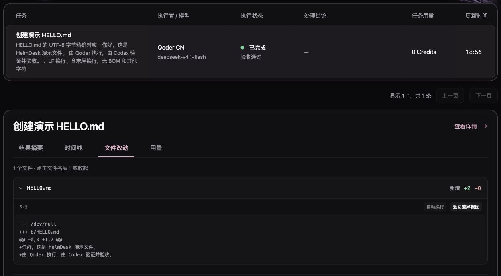

# HelmDesk 工作流演示 / Workflow demo

[观看 55 秒演示 / Watch the demo](https://github.com/Mu-Miao/HelmDesk/releases/download/v0.1.0-macos-preview.7/helmdesk-workflow-demo.mp4)



## 来源与范围

截图来自现有 HelmDesk 界面中的真实历史任务。该任务于 **2026-11-05** 由 Qoder 完成，在 Codex 宿主独立验证后单独验收；不是为了制作视频而再次执行。视频由真实界面截图和解释字幕剪辑而成，**非连续录屏，过程时间已压缩**。字幕补充解释，没有修改界面的执行、验证或验收状态。

English: This is a 55-second edited screenshot replay of a real historical task. It is not a continuous recording or a new execution. The host independently verified the complete delivery before recording acceptance. The screenshots preserve the actual UI state.

| 画面 | 展示内容 |
| --- | --- |
| 任务范围 | 仅允许 HELLO.md；UTF-8 无 BOM、恰好两行、每行 LF |
| 执行时间线 | 实际排队、准备、隔离预检与执行记录 |
| 文件差异 | 唯一新增文件 HELLO.md 的完整两行内容 |
| 独立验证 | 实际 89 字节、SHA-256 一致、原项目基线保持 |
| 验收 | 验证后记录 accepted，交付未整合回原项目 |

交付文件 SHA-256：

```text
bb8229d00941bb3775924b9084fcd30ca0442d1abedb8b7cc3c7e200b4d49984
```

截图按范围裁切，未包含个人路径、连接令牌、任务 UUID 或其他任务。截图中的 `0 Credits` 是上游原始记录，**不能证明没有发生模型消耗**。Skill 免费，模型调用可能收费。

展示的是已验证的 HELLO.md 入门场景。另一个函数修复演示未完成验证，不作为成功结果展示；本次没有重跑该任务。官方 Skill 的指令与示例为中文，验证范围为 macOS、Codex 宿主和 Qoder 执行器。

## 视频文件校验

MP4 为 55 秒、1920×1080、24 fps 的 H.264 视频；全部 1320 帧已实际解码检查。SHA-256：

```text
dec3b553fd41f049cc87f5a12dd064013668672aa10d9881c1a8e073edf15330
```

[下载视频校验文件](https://github.com/Mu-Miao/HelmDesk/releases/download/v0.1.0-macos-preview.7/helmdesk-workflow-demo.sha256)

## 快速入口

- [下载 Apple Silicon Mac 预发布版](https://github.com/Mu-Miao/HelmDesk/releases/tag/v0.1.0-macos-preview.7)
- [第一次任务教程](quickstart.md)
- [免费官方 Skill](https://www.agensi.io/skills/helmdesk-workflow-delegate-verify-review)
- [完整实践文章](https://blog.mashutaba.best/post/helmdesk-delegate-verify-review)
